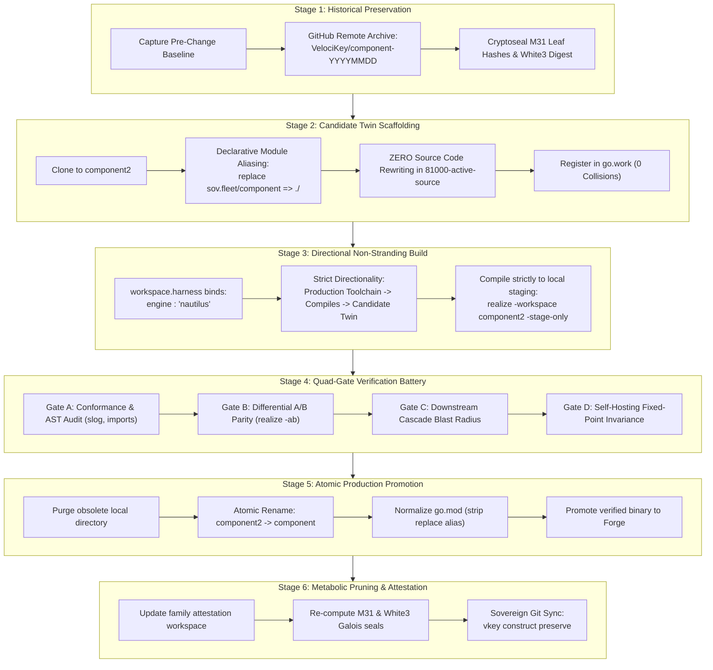

# Sovereign Major-Change Safe Development-to-Production Standard (Twin-Stratum Promotion Protocol)

> **Authoritative Fleet Governance Specification for High-Risk, Non-Trivial Architectural Evolutions**  
> Applicable to all Silos: `00flow`, `00floo`, `00flon`, `00ulib`, `00taut`, `00skim`, `00xper`

---

## 1. Executive Problem Statement & Motivation

Across a 470+ workspace monorepo, major architectural modifications—such as rewriting compiler stages (`nautilus`), re-architecting physical memory arenas (`plinth`), changing wire protocols (`ingress`/SACP), or updating ledger arithmetic (`commerce`)—carry severe systemic hazards if executed in-place:

1. **The Broken Trunk Hazard:** In-place mutations break intermediate builds and test suites, instantly stranding sibling workspaces that depend on the active package.
2. **The Bootstrapping Stranding Trap:** If a core toolchain compiler (`nautilus`), rehydrator (`realize`), or module manager (`sovmod`) is modified in-place and fails to build itself or emits broken code, the entire development workstation can become bricked.
3. **The Import Rewriting Penalty:** Historically, creating an experimental copy (`foo2`) required mass regex-replacing package imports across dozens of files, followed by an equally error-prone reverse replacement during merge-back.
4. **Unquantified Performance Regressions:** Functional tests may pass while subtle regressions in cacheline alignment, heap allocations, build duration, or silicon cycle counts go unnoticed without systematic A/B differential telemetry.
5. **Loss of Baseline Recoverability:** Without cryptosealed historical checkpoints, rolling back complex multi-workspace changes after downstream dependencies have mutated is high-friction and hazardous.

The **Sovereign Major-Change Safe Development-to-Production Standard** establishes a formal, deterministic, six-stage lifecycle that eliminates these hazards for **all component families**.

---

## 2. The Six-Stage Twin-Stratum Promotion Lifecycle



---

## 3. Detailed Specification of the Six Stages

### Stage 1: Historical Checkpoint & Baseline Cryptoseal
Before any code in a family or core workspace is mutated:
1. **GitHub Twin Snapshot:**
   Provision an immutable historical snapshot repository on GitHub:
   ```bash
   gh repo create VelociKey/<component>-YYYYMMDD --private --description "Historical baseline of <component> prior to <feature> modernization"
   ```
   Push the current `zenith` branch to this repository.
2. **Immutable Release Tag:**
   Tag the active repository:
   ```bash
   gh release create v<current_version>-baseline --repo VelociKey/<component> --target zenith --title "Pre-Modernization Baseline"
   ```
3. **Attestation Seal Capture:**
   Record the pre-change M31 leaf hash and White3 witness in `<family>/attestation/` to serve as the mathematical baseline for differential integrity checks.

---

### Stage 2: Candidate Twin Scaffolding & Zero-Rewrite Aliasing
When spinning up the candidate workspace (`<workspace>2` or `<family>2`):
1. **Directory Creation:**
   Clone `<workspace>` $\rightarrow$ `<workspace>2`.
2. **Declarative Module Aliasing (The Zero-Rewrite Mechanism):**
   In `<workspace>2/go.mod`, configure:
   ```go
   module sov.fleet/<workspace>2

   go 1.27

   require (
       sov.fleet/<workspace> v0.0.0
       ...
   )

   replace sov.fleet/<workspace> => ./
   ```
   - **The Mathematical Property:** Because Go's module resolver follows the `replace` directive, all 30+ internal imports in `81000-active-source/` (e.g. `import "sov.fleet/<workspace>/pkg"`) resolve strictly to the local directory inside `<workspace>2`.
   - **Zero Code Churn:** Not a single line of Go source code in `81000-active-source/` needs to be edited.
3. **Workspace DNA Declaration (`.workspace-dna.webnf`):**
   ```webnf
   [workspace]
   name = "<workspace>2"
   version = "1.0.0-candidate"
   clone_parent = "<workspace>"
   module_alias = "sov.fleet/<workspace>"
   is_candidate_twin = true
   ```
4. **Monorepo Registration:**
   Add `./<silo>/<workspace>2` to the root `go.work`. Because `<workspace>` and `<workspace>2` have distinct module identities, they co-exist concurrently with **zero module collisions**.

---

### Stage 3: Directional Non-Stranding Compilation
To prevent self-hosting tools or compilers from corrupting their own execution environment:
1. **Declarative Harness Binding (`workspace.harness`):**
   In `<workspace>2/71000-build-harness/workspace.harness`:
   ```webnf
   workspace_harness {
       name : "<workspace>2" ;
       test_enabled : true ;
       targets {
           target {
               mode : DYNAMIC ;
               engine : "nautilus" ;   ; Strictly binds trusted Stage 0 production compiler
               src : "81000-active-source" ;
               out : "<workspace>2" ;
               category : "BINARY" ;
           }
       }
   }
   ```
2. **Workspace-Isolated Staging:**
   All candidate builds are compiled strictly into local staging:
   ```powershell
   realize.exe -workspace <silo>/<workspace>2 -stage-only
   ```
   Output destination: `<workspace>2/96000-internal-executables/<workspace>2.exe`.
   The production Forge compiler in `00flow/forge/...` remains **completely untouched and read-only**.

---

### Stage 4: The Quad-Gate Verification Battery

Every candidate twin must pass four consecutive gates before promotion:

```
┌────────────────────────────────────────────────────────────────────────┐
│                   QUAD-GATE VERIFICATION BATTERY                       │
├────────────────────────────────────────────────────────────────────────┤
│ Gate A: Conformance & AST Compliance                                   │
│   • 100% Package Test Pass rate (realize -test -stage-only)            │
│   • vkey inspect audit-imports (0 forbidden packages)                  │
│   • vkey inspect slog-check (zero unstructured print statements)       │
│   • nontrivial security SAST audit (zero vulnerabilities)              │
├────────────────────────────────────────────────────────────────────────┤
│ Gate B: Differential A/B Parity (realize -ab)                          │
│   • Compilation latency delta: ΔT_compile <= target SLA                │
│   • Output isomorphism: Deterministic state equality                   │
│   • Execution throughput: >= 2.5x speedup or verified cycle parity    │
│   • Memory footprint: 0 B/op on critical paths; zero heap regressions  │
├────────────────────────────────────────────────────────────────────────┤
│ Gate C: Downstream Cascade Blast Radius                                │
│   • All immediate dependents in family compiled against candidate twin │
│   • Blast radius verification across silo boundaries                   │
├────────────────────────────────────────────────────────────────────────┤
│ Gate D: Self-Hosting / Fixed-Point Dogfooding                          │
│   • Candidate compiles itself: candidate.exe -workspace component2    │
│   • Emitted stage-3 binary passes 100% of unit test suites             │
└────────────────────────────────────────────────────────────────────────┘
```

---

### Stage 5: Production Promotion & Atomic Directory Swap

Upon passing all four gates:
1. **Local Directory Substitution:**
   - Remove obsolete local directory `<workspace>/` (which is safely preserved on GitHub as `VelociKey/<workspace>-YYYYMMDD`).
   - Atomically rename `<workspace>2/` $\rightarrow$ `<workspace>/`.
2. **Go Module Normalization:**
   - In `<workspace>/go.mod`: Change `module sov.fleet/<workspace>2` $\rightarrow$ `module sov.fleet/<workspace>`.
   - Remove the `replace sov.fleet/<workspace> => ./` directive.
   - Zero lines of source code in `81000-active-source/` are touched.
3. **Workspace DNA Update:**
   - Remove `is_candidate_twin = true` and `clone_parent`.
   - Increment build number and update timestamp in `.workspace-dna.webnf`.
4. **Monorepo Synchronization:**
   - Run `vkey construct status` or `mod-aligner` to clean `go.work`.
5. **Forge Promotion:**
   - Compile the verified source into the production Forge directory:
     ```powershell
     realize.exe -workspace <silo>/<workspace>
     ```

---

### Stage 6: Metabolic Pruning & Fleet Attestation

1. **Metabolic Pruning:**
   - Purge ephemeral scratch sandboxes (`00flow/hydrationcache/c0990-ephemeral-scratch/sandboxes/`).
   - Remove temporary A/B diagnostic traces and old binaries.
2. **Family Attestation Update:**
   - Re-run the family attestation suite in `<family>/attestation/`:
     ```powershell
     realize.exe -workspace <silo>/<family>/attestation -test -stage-only
     ```
   - Generate fresh M31 leaf hashes and White3 polynomial certificates.
3. **Remote Preservation Sync:**
   - Commit and push to the remote GitHub twin on the `zenith` branch:
     ```powershell
     vkey construct add -m "feat: promote candidate twin <workspace> to production"
     vkey construct preserve -silo <silo> -name <workspace>
     ```

---

## 4. Extending the Sovereign In-Process Module Engine (`sovmod`) to Automate the Twin Pipeline

A decisive architectural advantage of the VelociKey platform is that **the fleet does not depend on the external Go CLI (`go work`, `go mod tidy`, `go.sum`) for workspace orchestration**. 

Instead, the fleet owns and executes its own pure Go, zero-overhead in-process module engine: **`sovmod`** ([00ulib/substrate/sovmod](file:///c:/aCogSpaceSeed/00ulib/substrate/sovmod)).

### 4.1 The Core Components of `sovmod`

| `sovmod` Engine Component | Source File | Capability & Performance |
| :--- | :--- | :--- |
| **Monorepo DAG Resolver** | `dag_resolver.go` | In-process AST dependency crawl across 470+ workspaces in $< 15\text{ ms}$. |
| **Surgical Mod Tidier** | `mod_tidy.go` | In-process `go.mod` synthesis, dependency matching, and deterministic formatting ($< 50\text{ ms}$). |
| **Deterministic Work Generator** | `work_generator.go` | Generates canonical `go.work` declarations sorted and bounded by M31 polynomial orders. |
| **Galois Sum Engine** | `sum_engine.go` | Computes dual M31 polynomial leaf hashes and White3 cryptographic witness seals (`w3:...`). |
| **Parallel AST FastScanner** | `fastscan.go` | In-process Go AST parser extracting non-stdlib import specs concurrently in milliseconds. |

---

### 4.2 Three High-Leverage Extensions to `sovmod` for Candidate Twins

Because the fleet controls the Go code that synthesizes `go.mod` and `go.work`, we can extend `sovmod` to make the Twin-Stratum Promotion Lifecycle **100% automated**:

#### Extension 1: Self-Referential Intra-Twin Resolution in `mod_tidy.go`
In standard `TidyWorkspace()`:
- When a workspace declares `is_candidate_twin = true` and `twin_of = "<parent>"` in its `.workspace-dna.webnf`:
  1. `sovmod` automatically injects `replace sov.fleet/<parent> => ./` into the candidate's `go.mod`.
  2. In `dag_resolver.go`, when `fastscan` encounters imports matching `sov.fleet/<parent>/...`, `sovmod` recognizes them as **intra-twin local imports**. It does not flag them as missing or external dependencies.
  3. Result: **Zero manual edits** are required to make `<component>2` compile as a standalone, self-contained module.

#### Extension 2: Fleat-Wide Shadow Testing via `work_generator.go`
Currently, `GenerateGoWork()` lists all discovered workspaces in `use (...)`.
- We extend `sovmod` with a `--shadow-replace=<parent>:<twin>` directive.
- When active, `sovmod` writes an ephemeral `go.work` with:
  ```
  replace sov.fleet/<parent> => ./<silo>/<twin>
  ```
- **The Breakthrough:** This allows the *entire 470-workspace fleet* to instantly compile and run against the candidate twin (`<component>2`) during Gate C (Blast Radius Verification) **without modifying a single file in any workspace**. If anything breaks, reverting `go.work` takes $< 5\text{ ms}$.

#### Extension 3: The Atomic `sovmod.PromoteTwin` Functor
Instead of manual shell commands or error-prone multi-step scripts, we add a native promotion function to `sovmod`:
```go
// PromoteTwin executes an atomic, verified promotion of a candidate twin into production.
func PromoteTwin(projectRoot string, twinName string, targetName string) (*PromotionReport, error)
```
In $< 50\text{ ms}$, `PromoteTwin`:
1. Verifies that the GitHub baseline checkpoint (`VelociKey/<target>-YYYYMMDD`) is verified and locked.
2. Atomically replaces `<target>` directory with `<twin>`.
3. Rewrites the single module header in `go.mod` (`module sov.fleet/<target>`) and removes `replace sov.fleet/<target> => ./`.
4. Runs `TidyWorkspace` to normalize dependencies.
5. Re-generates `go.work` and computes fresh M31 / White3 seals in `<family>/attestation/`.

---

## 5. Family Archetype Matrix: Application Across Different Silos

| Family Archetype | Concrete Examples | Primary Catastrophic Risk | Specialized Gate Requirements |
| :--- | :--- | :--- | :--- |
| **I. Compilers & Toolchains** | `00flow/nautilus`, `00flow/fab-aides`, `00flow/hydration` | Self-hosting stranding, broken Macro-IR lowering | **Gate D Mandatory:** Self-compilation fixed-point invariance test; Stage 0 Forge harness binding. |
| **II. Low-Level Substrates & Memory Arenas** | `00ulib/substrate`, `00flow/plinth`, `00flow/adaptivelock` | Page fault panics, cacheline false sharing, GC regression | **Stage A/B Separation:** In-memory test shim $\to$ FileBacked mmap extent; `-gcflags="-m"` zero-allocation audit. |
| **III. Network & Routing Protocols** | `00flon/ingress`, `00flon/transport`, SACP Daemons | Framing corruption, packet drops, head-of-line blocking | **Zero-Copy SACP Loopback:** Framing parity test over loopback QUIC/UDP stream; wire codec verification. |
| **IV. Domain & Commercial Financial Engines** | `00floo/commerce`, `00floo/vaultline`, ISO 20022 | Rounding divergence, transaction desynchronization | **Sub-Atto Metrology:** $10^{-18}$ precision ledger audit, GAAP invariant verification, deterministic event replay. |
| **V. Mathematical & Formal Verification Proofs** | `00taut/proofs`, `00flow/adph`, Langlands Spanners | Mathematical unsoundness, broken invariants | **Lean 4 Prover Gate:** Formal proof check across all transformed theorems; category-theoretic functor audits. |

---

## 5. Architectural Checklist for Agents & Engineers

When initiating a non-trivial evolution on any component family, agents MUST follow this checklist:

```
[ ] 1. CHECKPOINT: Create VelociKey/<component>-YYYYMMDD on GitHub and push zenith.
[ ] 2. TAG: Create release tag v<current>-baseline on active repository.
[ ] 3. CLONE: Scaffold <component>2 with module sov.fleet/<component>2.
[ ] 4. ALIAS: Add 'replace sov.fleet/<component> => ./' to <component>2/go.mod.
[ ] 5. DNA: Add is_candidate_twin=true in <component>2/.workspace-dna.webnf.
[ ] 6. WORK: Add ./<silo>/<component>2 to go.work.
[ ] 7. HARNESS: Ensure engine : "nautilus" in <component>2/workspace.harness.
[ ] 8. EVOLVE: Implement non-trivial features inside <component>2/81000-active-source/.
[ ] 9. STAGE BUILD: Run realize.exe -workspace <component>2 -stage-only.
[ ] 10. CONFORMANCE: Run AST audits (audit-imports, slog-check, nontrivial).
[ ] 11. A/B VERIFY: Run realize.exe -workspace <component>2 -ab and verify performance deltas.
[ ] 12. DOGFOOD: Run self-compilation test if component is a compiler/toolchain.
[ ] 13. CASCADE: Verify sibling workspaces in family compile cleanly.
[ ] 14. SWAP: Atomically replace <component> with <component>2.
[ ] 15. NORMALIZE: Strip replace directive from go.mod; update .workspace-dna.webnf.
[ ] 16. ATTEST: Re-generate M31 leaf hashes in <family>/attestation/.
[ ] 17. PRESERVE: Run vkey construct preserve -silo <silo> -name <component>.
```
