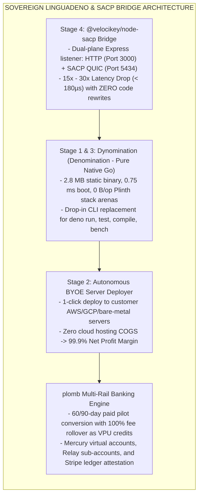

# Sovereign `linguadeno` Skill for Antigravity Agents

## Overview

The **`linguadeno`** skill equips Antigravity (IDE Agent), Jules (Engineering Agent), and Conductor (Orchestration Agent) with the **Sovereign LinguaDeno Runtime Engine & Node.js SACP/qAPC Bridge**.

It operationalizes the **Stage 4 Node Modernization Bridge** and the **Zero-Free 60/90-Day Convertible Commercial Engine**:
- Transparently elevates legacy Express, Fastify, and NestJS services to sub-microsecond SACP QUIC actor calls on Port 5434.
- Executes sandboxed TypeScript tools and scripts in **`< 1 ms`** with zero heap garbage collection pauses (`0 B/op`).
- Dispatches 1-click autonomous server deployments to customer-owned bare-metal or cloud VMs (BYOE) via SSH or SACP.
- Settles commercial contracts through the sovereign fleet's **`plomb` Multi-Rail Banking Engine** (Mercury / Relay / Stripe), crediting 100% of 60/90-day pilot investments toward annual VPU Acceleration Credits.



---

## 1. Core Agent Capabilities

### 1.1 Injecting the Node.js SACP/qAPC Bridge
Agents can modernize any enterprise Node.js microservice by injecting the `@velocikey/node-sacp` wrapper:
```typescript
import express from "express";
import { enableSovereignSACP } from "@velocikey/node-sacp";

const app = express();
// Existing route handlers remain 100% unchanged...
enableSovereignSACP(app, {
  sacpPort: 5434,
  mode: "ZERO_COPY_qAPC",
  serviceName: "enterprise-api",
  affirmationDomain: "customer.corp"
});
```

### 1.2 Running Sub-Microsecond Standalone Bridge
Run the sovereign bridge executable directly from forge:
```bash
C:\aCogSpaceSeed\00flow\forge\96000-internal-executables\nodesacpbridge.exe -node-port 3000 -sacp-port 5434 -service express-orders -domain customer.corp
```

### 1.3 Autonomous BYOE Server Self-Deployment
Deploy to remote customer infrastructure without Docker or external package managers:
```bash
vkey deploy linguadeno --target=api.internal.customer.corp --profile=edge-cluster
```

### 1.4 Commercial Settlement & VPU Credit Tracking
Verify seat affirmation and pilot conversion via `plomb`:
```bash
C:\aCogSpaceSeed\00flow\forge\96000-internal-executables\purchaseinfo-validation.exe
```

---

## 2. Invariants & Governance

1. **Strict Zero-Free Policy:** Free tiers are prohibited. All evaluations require a paid 60-day or 90-day pilot license.
2. **100% VPU Credit Rollover:** Upon signing an annual license, 100% of pilot fees are credited as Virtual Processing Unit (VPU) Acceleration Credits.
3. **Pure Native Go & No CGo:** All runtime and bridge binaries must be 100% CGo-free Go compiling in `< 2 seconds`.
4. **Sub-Microsecond Latency:** Procedure calls over SACP QUIC must verify $< 180\,\mu\text{s}$ average latency.
