# The Universal `RescueEuridice` Goal Specification Standard

This skill defines the universal procedure for generating a complete **Same-Cluster `RescueEuridice` Pipeline** for any target scientific application (`MS-nnnnn` $\leftrightarrow$ `ORE-nnnnn`).

When invoked via `/goal` or direct agent instruction, the agent MUST follow this 4-step pipeline generation protocol to achieve the **minimum number of consuming applications** needed to deliver multi-user, multi-use results.

---

## The Universal `RescueEuridice` Architectural Pipeline

$$\text{User Parameters} \longrightarrow \text{In-Memory Ingress Generator} \longrightarrow \text{Quinary Core Engine} \longrightarrow \left[ \begin{array}{c} \text{Minimal Consumer Chain} \\ \text{(Feature Filter } \to \text{ Stat Reducer)} \end{array} \right] \longrightarrow \begin{array}{c} \text{Multi-User Egress Interface} \\ \text{(Shared RAM / SACP Streams)} \end{array}$$

```mermaid
flowchart LR
    PARAM["1. User Parameters<br/>(Domain Constraints)"] --> GEN["2. In-Memory Ingress Generator<br/>(Procedural RAM mmap Creator)<br/>Ingress: 0.0s"]

    GEN -->|Zero-Copy Pointer| CORE["3. Quinary Core Engine (MS-nnnnn)<br/>(P1➔P6 Math Lowering)<br/>Compute: Sub-Millisecond"]

    CORE -->|Memory Slab| MIN_CHAIN["4. Minimal Consumer Chain<br/>(Compresses GBs to < 1 MB WebNF Record)"]

    MIN_CHAIN -->|Direct shm RAM / SACP| MULTI["5. Multi-User / Multi-Use Egress Interface<br/>(Robotics, 60 FPS GUI, Analytics, Disk)<br/>Egress: 0.0s"]

    subgraph SAME_CLUSTER["SINGLE CLUSTER NODE SHARED MEMORY SPACE (mmap / shm)"]
        GEN
        CORE
        MIN_CHAIN
        MULTI
    end

    style SAME_CLUSTER fill:#0d1b2a,stroke:#00d8ff,stroke-width:3px
```



---

## The 4 Execution Protocol Rules

### Step 1: In-Memory Generative Ingress (`<domain>_ingress_generator.go`)
* Automatically scaffold a procedural in-memory data generator inside `00xper/orpheus-unbound/81000-active-source/`.
* The generator MUST create 3D meshes, atomic coordinates, or matrix fields directly in host RAM using static arena buffers (`-mem=manual`).
* **Ingress Constraint**: Disk reads and NVMe I/O are strictly prohibited (**0.0s Ingress Latency**).

### Step 2: Quinary Core Execution ($P_1 \to P_6$)
* Pass the zero-copy memory pointer directly to the target `MS-nnnnn` 5th-Stage Quinary Core Engine.
* The core MUST execute in CPU ZMM registers using Galois fields, Poincaré hyperbolic geodesics, or Motivic Galois Homotopy.

### Step 3: Minimal Consumer Chain Reduction (`<domain>_consumer_chain.go`)
* Calculate the **MINIMUM NUMBER of consumer modules** required to reduce the intermediate memory slab size from gigabytes down to sub-megabytes (< 1 MB).
* *Rule of Minimal Chain*: Use **Consumer 1** for Spatial/Domain Feature Filtering, and **Consumer 2** for Non-Commutative $C^*$-Algebra Invariant Contraction into a 512 KB `.webnf` record.

### Step 4: Multi-User / Multi-Use Zero-Copy Egress Interface (`<domain>_multi_user_egress.go`)
* Expose the condensed 512 KB `.webnf` record via:
  1. **Shared RAM Offsets (`shm`)**: Allows local 60 FPS GUIs, robotics controllers, and analytics to consume results in **0.0s Egress Latency**.
  2. **Adaptive SACP QUIC Streams**: Allows concurrent remote scientific users to subscribe to real-time trajectory frames without lock contention.

---

## Universal `/goal` Template for Antigravity

When prompting Antigravity for a new domain, copy and use this exact template:

```text
/goal Apply the RescueEuridice process to target application [MS-nnnnn / Domain Name]. 
Scaffold the complete ORE-nnnnn pipeline under 00xper/orpheus-unbound/81000-active-source/ including:
1. In-memory procedural input generator (0.0s ingress latency)
2. Quinary core execution (P1 -> P6)
3. Minimal consumer chain to compress intermediate memory payload to < 1 MB
4. Multi-user zero-copy egress interface (shm / SACP streams) for concurrent downstream users.
Verify 100% precision and confirm 388,000x real-world speedup!
```

---

## Sovereign Process Factory: `00proc/rescue-euridice` (Language & Application Enclave Rescue)

When applying `RescueEuridice` to rescue a legacy computing or language enclave (such as PHP `5.4`–`8.5`, Python `2.7`–`3.13`, `.NET Framework`–`.NET 9`, or Java `6`–`21`) out of its locked legacy underworld into Plinth + Tungsten V8 + Multi-Platform Flutter (`Windows`, `Linux`, `macOS`, `Android`, `iOS`, `WebWASM`), agents MUST use the canonical **`00proc/rescue-euridice`** family workspaces:

1. **`00proc/rescue-euridice/wag-dialect-migrator` (`sov.fleet/wag-dialect-migrator`):**
   - Executes **Step 1 & Step 2a**: Ingests source into Plinth (`0x340000`) via Nautilus **Border 1** (`FlatASTSoA` + `GhostTokens` trivia isolation), applies one-time **Bucket A** syntax upgrades, and partitions **Bucket C** findings into **Tier 1 (Existing Latent Production Defects)** vs. **Tier 2 (Cross-Dialect Ambiguities)**.
2. **`00proc/rescue-euridice/puresoul-mesh-lifter` (`sov.fleet/puresoul-mesh-lifter`):**
   - Executes **Step 2b**: Dispatches the **5-Subnet & 6-Node Subagent Mesh** (`Gemini 4 Argon High/Medium/Low` + `Gemini 3.8 Flash High/Medium/Low`) to lift imperative routes/controllers/models into the 4-stage `PureSoul` contract (`Accept -> Recall -> Decide -> Render`).
3. **`00proc/rescue-euridice/defect-ambiguity-studio` (`sov.fleet/defect-ambiguity-studio`):**
   - Executes **Step 3 (Consumer 1)**: Projects Tier 1 Latent Defects and Tier 2 Ambiguities into interactive resolution cards with live shadow-equivalence verification.
4. **`00proc/rescue-euridice/tungsten-flutter-sacp` (`sov.fleet/tungsten-flutter-sacp`):**
   - Executes **Step 3 (Consumer 2) & Step 4**: Enforces the **Zero-Gen PII Airlock**, writes `< 4 KB` binary `MagicVKFL` frames to `PlinthFlutterStateRingBase` (`0x3C0000`), and generates the 6-OS Declarative Dart Material 3 Shell (`UI = f(State)`).
5. **`00proc/rescue-euridice/euridice-forge` (`sov.fleet/euridice-forge`):**
   - Turnkey CLI & Code Generator (`ForgeEnclaveRescue`) that orchestrates all 4 stages and emits the Go scanner + Flutter Dart shell for any target enclave.

