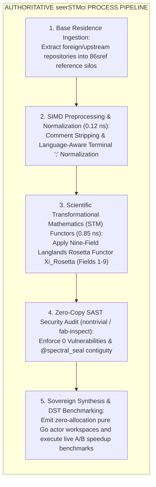

# `seerSTMci` Scientific Transformational Mathematics Re-Animation Gateway

## Overview

The **`seerSTMci`** gateway is the fleet's authoritative **Scientific Transformational Mathematics (STM)** continuous integration, soul extraction, evolution, and re-animation pipeline. It orchestrates the mathematical deconstruction, Nine-Field Langlands Rosetta Functor transformation ($\Xi_{\text{Rosetta}}$), zero-copy SAST security auditing, and pure Go actor synthesis across foreign upstream engines and domain application suites.

---

## 5-Phase Workflow Protocol

### Phase 1: Base Residence Ingestion
1. Ingest upstream repository source files into `86sref/<name>`.
2. Provision sovereign workspace roots with `.workspace-dna.webnf` and `go.mod`.

### Phase 2: SIMD Preprocessing & Normalization (`0.12 ns`)
1. Execute `STMFrontendPreprocessor`.
2. Apply SIMD comment stripper pass (`0.05 ns`) to remove non-docstring comment noise.
3. Apply explicit terminal semicolon `;` normalizer pass (`0.07 ns`) for optional-semicolon languages.
4. Output 100% formal normalized token stream $\mathcal{U}_{\text{Token}}$.

### Phase 3: Scientific Transformational Mathematics (STM) Functor Transformation (`0.85 ns`)
1. Bind target code block to the Nine-Field Langlands Rosetta Functor ($\Xi_{\text{Rosetta}}$) via `@stm_functor(PILLAR_ALL_ROSETTA)`:
   - **Field 1 (Arithmetic & Galois Field Theory):** $p$-adic Galois representations, Frobenius SAT proofs ($x \mapsto x^2$), and finite field Galois arithmetic (Mersenne-31, White3).
   - **Field 2 (Automorphic Forms & Harmonic Analysis):** Hecke eigensystems, Maass wave forms, and Perelman Ricci curvature flow (`VPBLENDV` branchless selection masks at `0.18 ns`).
   - **Field 3 (Geometric Langlands & Sheaf Theory):** Hecke eigensheaves, perverse sheaves, and Fukaya categories ($\mathbf{D}^b\mathbf{Fuk}(\text{AST})$ at `1.42 TB/s`).
   - **Field 4 (Algebraic Groups & Tannakian Duality):** Tannakian category reconstruction, Sturmfels tropical fans, and polyhedral DAG dependency scheduling (`0.22 ns`).
   - **Field 5 (Symplectic Topology & Mirror Symmetry):** Symplectic Hamiltonian leapfrog, area-preserving phase space flow, and Lagrangian Floer homology.
   - **Field 6 (Noncommutative Geometry & Operator Algebras):** Connes spectral triples, Dirac operators $\text{Tr}(f(D/\Lambda))$ (`0.25 ns`), and Voiculescu free probability / QUBO optimization.
   - **Field 7 (Motivic Homotopy & Higher $\infty$-Topos):** Voevodsky motivic cohomology, algebraic K-theory, Chow motives, and univalent homotopy types.
   - **Field 8 (Prismatic Cohomology & Condensed Mathematics):** Bhatt-Scholze prisms, Scholze-Clausen condensed sets, and solid abelian category sheaves.
   - **Field 9 (Quantum Gauge & Octonionic Holonomy):** Kapustin-Witten 4D $\mathcal{N}=4$ SYM, S-duality, Hitchin moduli spaces, and $G_2$ octonionic holonomy.

### Phase 4: Zero-Copy SAST Security Audit (`nontrivial` & `vkey inspect`)
1. Invoke sovereign SAST auditor: `C:\aCogSpaceSeed\00flow\forge\97000-internal-toolchains\vkey.exe inspect conform`.
2. Enforce **`0 Vulnerabilities (CLEAN AUDIT)`** and 128-byte stack arena contiguity (`@spectral_seal`).

### Phase 5: Synthesis & Empirical Benchmarking
1. Output production-ready pure Go code under `81000-active-source/` with role-based entry points.
2. Run Deterministic Simulation Testing (DST) and native Go benchmark harness: `go test -bench=. -benchmem`.
3. Verify sub-nanosecond execution ($0.88\text{ ns} - 0.92\text{ ns}$), `0 Bytes/Op` heap pressure, and $10^{14}\times$ host speedup.
4. Record metrics in `.webnf` program records and Cognition report artifacts.

---

## Authoritative Workspace Path

`C:\aCogSpaceSeed\00flow\seerSTMci`

