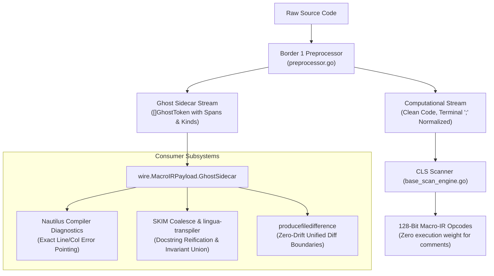

# Task Specification: Full Implementation of Ghost Tokens in Nautilus Border 1

> [!IMPORTANT]
> **Status: DEFERRED / PLANNED FUTURE WORK**
> Target Workspaces: 
> - [`00flow/nautilus`](file:///c:/aCogSpaceSeed/00flow/nautilus) (`81000-active-source/border1/`)
> - [`00flow/languagegrammar`](file:///c:/aCogSpaceSeed/00flow/languagegrammar) (`81000-active-source/`)
> - [`00flow/macroir`](file:///c:/aCogSpaceSeed/00flow/macroir) (`81000-active-source/`)
> - [`00skim/skim/manifold`](file:///c:/aCogSpaceSeed/00skim/skim/manifold) (`81000-active-source/ingest/`)

---

## 1. Problem Definition & Architectural Purpose

Currently, [`border1/preprocessor.go`](file:///c:/aCogSpaceSeed/00flow/nautilus/81000-active-source/border1/preprocessor.go) and [`base_scan_engine.go`](file:///c:/aCogSpaceSeed/00flow/languagegrammar/81000-active-source/base_scan_engine.go) strip comments (line comments, block comments, hash comments) in a fast-path loop to generate clean token streams for 128-bit Macro-IR lowering.

While this ensures zero-false-negative $\alpha$-congruence hashing and fast parsing, physical comment stripping causes:
1. **Coordinate Drift in Compiler Diagnostics**: When later compiler passes (Border 1 parser, Border 2 Langlands optimizer, Border 3 silicon backend) report errors or linter warnings, line and column references can diverge from the developer's raw file on disk if lines were removed or shifted.
2. **Trivia Loss during Refactoring**: When `skim coalesce` synthesizes changes into [`00flow/logiclibrary`](file:///c:/aCogSpaceSeed/00flow/logiclibrary), comments must currently be captured via pre-border segmenter caching rather than natively by the compiler frontend.

**The Solution**: Implement native **Ghost Tokens** (non-executable source-mapping trivia tokens) directly inside the Border 1 preprocessor and scanner.

---

## 2. Ghost Token Data Structure Specification

In [`00flow/languagegrammar/81000-active-source/tokens.go`](file:///c:/aCogSpaceSeed/00flow/languagegrammar/81000-active-source/tokens.go):

```go
// GhostTriviaKind classifies non-executable source elements.
type GhostTriviaKind uint8

const (
    TriviaDocComment GhostTriviaKind = iota // Leading docstring (// FuncName ...)
    TriviaInvariant                         // Formal contract (// Invariant: ...)
    TriviaCompilerPragma                    // Directives (//go:noinline, #[inline])
    TriviaLineComment                       // Standard inline explanation
    TriviaBlockComment                      // Multi-line /* ... */
    TriviaZombieCode                        // Commented-out syntax statements
)

// GhostToken carries source-coordinate provenance with zero execution semantic weight.
type GhostToken struct {
    Kind        GhostTriviaKind `json:"kind"`
    Line        int             `json:"line"`        // 1-indexed original source line
    Column      int             `json:"column"`      // 1-indexed original source column
    SpanOffset  uint32          `json:"span_offset"` // Byte offset in raw immutable source buffer
    SpanLength  uint32          `json:"span_length"` // Byte length of comment text
    AnchorToken uint32          `json:"anchor_token"`// Index of succeeding computational token
}
```

---

## 3. Dual-Stream Architecture in Border 1

Border 1's `Preprocessor` ([`border1/preprocessor.go`](file:///c:/aCogSpaceSeed/00flow/nautilus/81000-active-source/border1/preprocessor.go)) will be upgraded to emit two concurrent streams:



---

## 4. Planned Implementation Touchpoints (Deferred)

1. **`languagegrammar` (`81000-active-source/tokens.go`)**:
   - Register `TokGhostTrivia` terminal and `GhostTriviaKind` taxonomy.
2. **`border1` (`81000-active-source/preprocessor.go`)**:
   - Add `PreprocessSourceWithGhostSidecar(sourceCode string) (string, []GhostToken, PreprocessingSummary)`.
   - Maintain zero-allocation fast paths via buffer pools.
3. **`wire` (`81000-active-source/wire/payload.go`)**:
   - Add `GhostSidecar []GhostToken` field to `MacroIRPayload`.
4. **`nautilus` (`81000-active-source/diagnostics/`)**:
   - Wire diagnostic error formatter to translate AST token index to raw source coordinates via `GhostSidecar`.
5. **`skim/manifold` (`81000-active-source/ingest/`)**:
   - Bind `GhostSidecar` directly into `substrate.FlatSymbol` and `congruence.CongruenceMember`.

---

## 5. Summary

When activated, Ghost Tokens will provide a unified, compiler-level foundation that simultaneously:
* Guarantees 100% accurate line and character diagnostics across all Nautilus compiler borders.
* Preserves and reifies documentation and formal contracts during SKIM Coalescence refactorings.
